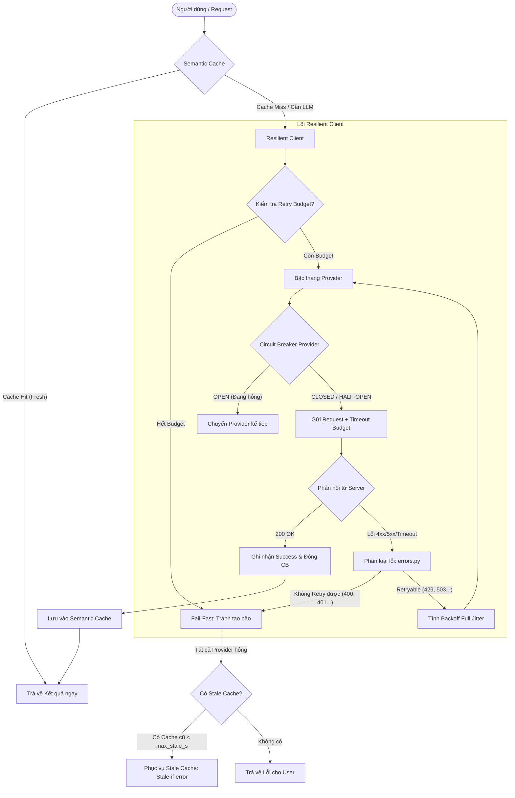
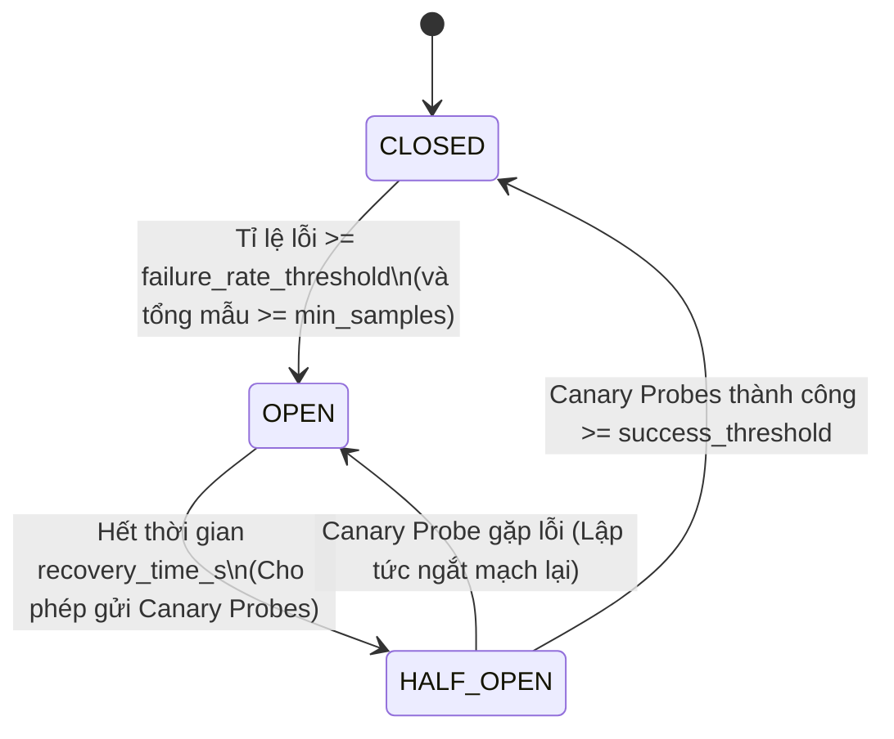
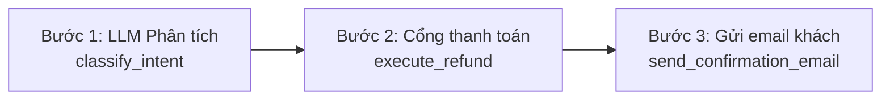

# TÀI LIỆU TOÀN DIỆN: KIẾN TRÚC HỆ THỐNG VÀ GIẢI PHÁP BỀN VỮNG (RESILIENCE ENGINEERING)
> **Tài liệu học tập & Phân tích chuyên sâu Lab 25B**  
> **Tác giả:** Nguyễn Phương Nam — MSV: `2A202602869`  
> **Chủ đề:** *Distributed Systems Resilience, Retry Storms, Circuit Breakers, Multi-Provider Fallbacks, Exactly-Once Durable Workflows, Multi-Window SLO Alerting & Semantic Caching.*

---

## MỤC LỤC
1. [Bối cảnh & Bài toán cốt lõi: Tại sao một Client "Ngây Thơ" lại giết chết Hệ Thống?](#1-bối-cảnh--bài-toán-cốt-lõi)
2. [Kiến trúc tổng thể của Hệ Thống Bền Vững](#2-kiến-trúc-tổng-thể)
3. [Phần 1: Phân loại lỗi thông minh (`errors.py`)](#3-phần-1-phân-loại-lỗi-thông-minh)
4. [Phần 2: Chiến lược Retry & Chống bão Retry (`retry.py`)](#4-phần-2-chiến-lược-retry--chống-bão-retry)
5. [Phần 3: Circuit Breaker Cửa sổ trượt (`breaker.py`)](#5-phần-3-circuit-breaker-cửa-sổ-trượt)
6. [Phần 4: Resilient Client & Bậc thang Fallback đa nhà cung cấp (`client.py`)](#6-phần-4-resilient-client--bậc-thang-fallback)
7. [Phần 5: Quy trình Hoàn tiền Bền vững Exactly-Once (`workflows/executor.py`)](#7-phần-5-quy-trình-hoàn-tiền-bền-vững-exactly-once)
8. [Phần 6: Giám sát SLO & Cảnh báo Multi-Window Multi-Burn-Rate (`slo/alerting.py`)](#8-phần-6-giám-sát-slo--cảnh-báo-burn-rate)
9. [Phần 7: Semantic Cache & Cơ chế Stale-if-error (`cache.py`)](#9-phần-7-semantic-cache--stale-if-error)
10. [Tổng kết các bài học SRE "xương máu" từ Game Day](#10-tổng-kết-các-bài-học-sre-xương-máu)

---

## 1. BỐI CẢNH & BÀI TOÁN CỐT LÕI

### 1.1. Bối cảnh thực tế
Trong kiến trúc Microservices và ứng dụng GenAI (LLM) hiện đại, dịch vụ của bạn phụ thuộc mật thiết vào các API bên thứ ba (OpenAI, Google Gemini, Anthropic, DeepSeek, Payment Gateways, v.v.). Các dịch vụ này **chắc chắn sẽ gặp sự cố** vào một thời điểm nào đó:
- Quá tải GPU đột ngột (Overload / Capacity crunch).
- Cháy quota API (Rate limit 429).
- Đứt cáp quang biển, mạng chập chờn (Network packet drops, slow response).
- Đội ngũ vendor deploy nhầm code lỗi (Bad deployment / 500 Internal Error).
- Sập hoàn toàn cụm Cloud (Outage toàn diện).

### 1.2. Thảm họa từ Client "Ngây Thơ" (`NaiveClient`)
Hầu hết lập trình viên khi mới xây dựng client thường áp dụng tư duy đơn giản:
```python
# TƯ DUY NGÂY THƠ NGUY HIỂM:
for attempt in range(max_retries):
    try:
        return call_api()
    except Exception:
        time.sleep(1) # Hoặc retry ngay lập tức!
```
Hành vi này dẫn đến những thảm họa thực tế sau:
1. **Bão Retry (Retry Storm):** Khi server bắt đầu quá tải và phản hồi chậm, hàng ngàn client cùng bị timeout. Client lập tức retry lại cùng một lúc. Lượng request dội về server tăng gấp 5–15 lần (`amplification > 10x`). Thay vì giúp server hồi phục, client đã tự tay "DDoS" hạ gục hoàn toàn hạ tầng của mình.
2. **Cộng hưởng tải (Resonance & Spikes):** Nếu không có ngẫu nhiên hóa thời gian chờ (Jitter), hàng ngàn client sẽ retry vào đúng các mốc thời gian cố định ($t = 1s, 2s, 4s...$), tạo ra những đợt sóng xung kích (traffic spikes) dập nát hàng đợi của server.
3. **Thất bại giả bền vững (Metastable Failure):** Server mất 155 giây sau khi hết sự cố mới có thể phục vụ lại, vì hàng đợi FIFO của server vẫn đang mải miết tính toán cho các request cũ mà client ở ngoài đã bỏ cuộc (abandoned/cancelled) từ lâu.
4. **Tiêu tốn chi phí vô nghĩa & Trùng lặp thanh toán:** Retry mù quáng các lỗi 4xx (như 400 Bad Request, 401 Unauthorized) làm cháy sạch ngân sách gọi LLM; trong quy trình thanh toán, retry không có Idempotency Key sẽ khiến khách hàng bị trừ tiền 2 lần hoặc nhận 2 lần hoàn tiền.

---

## 2. KIẾN TRÚC TỔNG THỂ

Hệ thống được thiết kế theo mô hình **Phòng thủ Đa Lớp (Defense-in-Depth)**:



---

## 3. PHẦN 1: PHÂN LOẠI LỖI THÔNG MINH (`errors.py`)

### 3.1. Nguyên lý phân loại
Không phải mọi lỗi HTTP hay Network đều giống nhau. Việc xử lý lỗi sai cách sẽ biến lỗi nhỏ thành thảm họa hệ thống.

```
                    ┌─────────────────────────┐
                    │      Gặp Exception      │
                    └────────────┬────────────┘
                                 │
                 ┌───────────────┴───────────────┐
                 ▼                               ▼
       Network / Transport                 HTTP Status Code
    (Connection, Timeout, DNS)                   │
                 │                               │
                 │                ┌──────────────┴──────────────┐
                 │                ▼                             ▼
                 │             4xx (Client)                  5xx (Server)
                 │         400, 401, 403, 404...             500, 502, 503, 504
                 │                │                             │
                 │                ├─ Ngoại lệ: 429             │
                 │                │  (Rate Limited)             │
                 ▼                ▼                             ▼
          [RETRYABLE = TRUE]  [RETRYABLE = FALSE]       [RETRYABLE = TRUE]
```

### 3.2. Bảng ma trận quyết định

| Mã lỗi / Tình huống | `is_retryable` | `counts_toward_breaker` | `failover_helps` | Giải thích bản chất kỹ thuật |
|---|:---:|:---:|:---:|---|
| **400 Bad Request** | ❌ False | ❌ False | ❌ False | Do client gửi format sai. Gửi lại 1000 lần vẫn sai. Nếu tính vào breaker của server, kẻ tấn công chỉ cần gửi vài request 400 là ngắt luôn toàn bộ hệ thống của server! |
| **401 / 403 Forbidden** | ❌ False | ❌ False | ❌ False | Sai API key hoặc không có quyền. Retry chỉ làm tốn tài nguyên. |
| **404 Not Found** | ❌ False | ❌ False | ❌ False | Tài nguyên không tồn tại, retry không thể làm nó xuất hiện. |
| **429 Rate Limit (RPM/TPM)** | ✅ True | ❌ False | 🔄 Tùy thuộc | Bị nghẽn tạm thời. Retry được (sau `Retry-After`). Không tính vào breaker server vì server không bị crash, nó chỉ đang bảo vệ nó. Failover sang provider khác nếu bị kẹt quota. |
| **500 Internal Error** | ✅ True | ✅ True | ✅ True | Lỗi logic server. Cần backoff retry hoặc failover sang provider dự phòng. |
| **502 / 503 / 504** | ✅ True | ✅ True | ✅ True | Server sập, bảo trì hoặc gateway timeout. Chắc chắn phải đếm lỗi vào Circuit Breaker và lập tức failover. |
| **ConnectionError / Timeout** | ✅ True | ✅ True | ✅ True | Lỗi đường truyền, nghẽn mạng cục bộ. Retry và chuyển vùng/provider. |

---

## 4. PHẦN 2: CHIẾN LƯỢC RETRY & CHỐNG BÃO RETRY (`retry.py`)

### 4.1. Thuật toán Exponential Backoff với Full Jitter
- **Vấn đề của Backoff cố định ($t = b \times 2^i$):**
  Nếu 100 client cùng gặp lỗi ở $t=0$, tất cả sẽ ngủ $1s$, rồi cùng thức dậy bắn phá server ở $t=1s$, lại cùng ngủ $2s$, rồi cùng bắn phá ở $t=3s$. Server liên tục bị các xung tải (spikes) làm sập.
- **Giải pháp Full Jitter (Khuyến nghị bởi AWS Architecture):**
  $$t \sim \text{Uniform}(0, \min(\text{cap\_s}, \text{base\_s} \times 2^{\text{attempt}}))$$
  Thời gian chờ được rải đều ngẫu nhiên từ $0$ đến trần lũy thừa. Tải retry được làm phẳng hoàn toàn theo trục thời gian, triệt tiêu mọi xung cộng hưởng.
- **Tôn trọng header `Retry-After`:**
  Nếu server trả về header `Retry-After: 4.5`, client **bắt buộc** phải tuân thủ chờ tối thiểu $4.5s$ trước khi thử lại, không được phép retry sớm hơn.

### 4.2. Cơ chế Ngân sách Retry (Retry Budget)
Retry Budget hoạt động như một Token Bucket để giới hạn số lượt retry trong toàn hệ thống:
- Trong trạng thái bình thường (100% request thành công), hệ thống tích lũy token retry dựa trên tỷ lệ `max_retry_ratio` (ví dụ: $0.2 = 20\%$). Cứ 10 request ban đầu thành công thì hệ thống được cấp phép tối đa 2 lượt retry.
- Đảm bảo một sàn tối thiểu (`min_retries_per_sec = 5.0`) để các request đơn lẻ ban đêm không bị nghẽn vô cớ.
- **Tác dụng cứu mạng khi sự cố diện rộng:** Khi server sập hoàn toàn (100% lỗi), không có request thành công nào được nạp thêm token. Ngân sách retry nhanh chóng cạn kiệt về $0$. Hệ thống lập tức dừng toàn bộ các nỗ lực retry vô vọng, chặn đứng hiện tượng Bão Retry (Amplification giảm từ $9.9\times$ của Naive xuống còn $1.04\times$).

---

## 5. PHẦN 3: CIRCUIT BREAKER CỬA SỔ TRƯỢT (`breaker.py`)

Circuit Breaker ngăn chặn client liên tục gửi request đến một dịch vụ đang hấp hối, giúp dịch vụ đó có thời gian và không gian để hồi phục.



### 5.1. Ba trạng thái hoạt động
1. **`CLOSED` (Đóng mạch - Bình thường):** Request đi qua bình thường. Mọi kết quả (thành công/thất bại) được ghi nhận vào hàng đợi trượt theo thời gian.
2. **`OPEN` (Ngắt mạch - Dịch vụ chết):** Client chặn đứng toàn bộ request từ nguồn (`fail-fast`). Không gửi thêm bất kỳ byte nào qua mạng. Request bị từ chối ngay lập tức với lỗi `CircuitOpenError` hoặc chuyển thẳng sang Provider kế tiếp trên bậc thang Fallback.
3. **`HALF-OPEN` (Nửa mở - Thử nghiệm thăm dò):** Sau khi hết thời gian chờ `recovery_time_s` (ví dụ: $15s$), breaker chuyển sang trạng thái thăm dò. Nó chỉ cho phép một số lượng request giới hạn đi qua (Canary Probes).
   - Nếu các request thăm dò này thành công: Breaker tin tưởng server đã sống lại $\to$ chuyển về `CLOSED`.
   - Nếu bất kỳ probe nào thất bại: Breaker biết server vẫn đang hấp hối $\to$ lập tức bật lại `OPEN` và reset thời gian recovery.

### 5.2. Tại sao phải dùng Cửa sổ trượt theo thời gian (Sliding Window)?
Thay vì chỉ đếm số lỗi liên tiếp (dễ bị reset sai lệch nếu có 1 request tình cờ thành công), Sliding Window lưu trữ toàn bộ lịch sử trong $W$ giây gần nhất (ví dụ: $30s$).
- Tự động xóa bỏ các mẫu lỗi cũ ngoài cửa sổ thời gian.
- **Điều kiện ngắt mạch kép an toàn:**
  $$\text{Tổng request trong cửa sổ} \ge \text{min\_samples} \quad \text{VÀ} \quad \frac{\text{Số lỗi}}{\text{Tổng request}} \ge \text{failure\_rate\_threshold}$$
  Điều này ngăn chặn việc ngắt mạch nhầm lẫn vào ban đêm (khi hệ thống chỉ có 2 request và 1 request bị timeout $\to 50\%$ lỗi nhưng `total < min_samples`).

---

## 6. PHẦN 4: RESILIENT CLIENT & BẬC THANG FALLBACK (`client.py`)

### 6.1. Bậc thang Fallback đa nhà cung cấp (Multi-Provider Ladder)
Trong file cấu hình [`configs/gameday.yaml`](file:///Users/namdev/Documents/Code/VinAI/Track3-Day25-2A202602869-NguyenPhuongNam/configs/gameday.yaml):
```
1. gemini-primary (Vendor chính - Giá tối ưu, Region gần)
      │ (Gặp lỗi mạng / 5xx / Circuit Breaker OPEN)
      ▼
2. gemini-secondary (Cùng vendor - Khác region vật lý)
      │ (Cả vendor sập hoặc lỗi diện rộng)
      ▼
3. deepseek-fallback (Vendor độc lập hoàn toàn)
```

### 6.2. Các quy tắc điều phối thông minh
- **Mỗi Provider có Circuit Breaker riêng:** Nếu `gemini-primary` bị sập, chỉ breaker của nó mở. `gemini-secondary` và `deepseek-fallback` vẫn ở trạng thái `CLOSED` để đón nhận traffic failover.
- **Quản lý Deadline / Budget Thời gian toàn cục:**
  Mỗi user request có một `overall_timeout_s` (ví dụ: $15s$). Dù có retry hay failover qua bao nhiêu nhà cung cấp, tổng thời gian không bao giờ được vượt quá deadline này. Khi deadline chỉ còn $< 0.1s$, client lập tức fail-fast thay vì gửi một request vô vọng.
- **Xử lý Timeout "Survivorship Bias":** Không đặt `attempt_timeout_s` quá ngắn. Nếu đặt timeout $2s$ trong khi server đang xử lý mất $3s$, client sẽ cắt bỏ các request đang xử lý dở, khiến availability tụt dốc thảm hại.

---

## 7. PHẦN 5: QUY TRÌNH HOÀN TIỀN BỀN VỮNG EXACTLY-ONCE (`workflows/executor.py`)

### 7.1. Bài toán Hoàn tiền (Refund Workflow)
Quy trình nghiệp vụ gồm 3 bước tuần tự:

Trong môi trường phân tán, máy chủ thực thi có thể bị **crash đột ngột (Kernel Panic, OOM, Restart pod)** ở bất kỳ mili-giây nào giữa 3 bước trên.

### 7.2. Giải pháp Checkpointing & Idempotency Key
Nếu server khởi động lại sau crash, làm sao để tiếp tục quy trình mà **không hoàn tiền 2 lần (mất tiền doanh nghiệp)** và **không gửi 2 email cho khách**?

1. **Idempotency Key duy nhất:**
   $$\text{idempotency\_key} = f(\text{order\_id}, \text{step\_name})$$
   Khi gọi API cổng thanh toán, client đính kèm key này. Cổng thanh toán cam kết nếu nhận được cùng một key, nó chỉ thực hiện trừ/cộng tiền đúng 1 lần duy nhất và trả về kết quả cũ.
2. **Durable Checkpointing (`DurableStore`):**
   Sau khi mỗi bước hoàn thành thành công, executor lập tức lưu kết quả vào kho lưu trữ bền vững (`DurableStore.put(checkpoint_key, step_result)`).
3. **Cơ chế Tái khởi động (Resume after Crash):**
   Khi workflow chạy lại sau crash:
   - Trước khi thực thi mỗi bước, executor kiểm tra `checkpoint_key` trong store.
   - Nếu kết quả của bước đó **đã tồn tại**: Bỏ qua việc thực thi (không gọi lại LLM tốn token, không gọi lại payment gateway), lấy thẳng kết quả từ checkpoint và nhảy sang bước kế tiếp!
   - Kết quả: **0 duplicate refunds, 0 duplicate emails, 0 lost refunds, lãng phí token LLM gần như bằng 0**.

---

## 8. PHẦN 6: GIÁM SÁT SLO & CẢNH BÁO MULTI-WINDOW MULTI-BURN-RATE (`slo/alerting.py`)

### 8.1. Khái niệm SLO và Tốc độ Đốt Ngân sách (Burn Rate)
- **SLO (Service Level Objective):** Cam kết chất lượng dịch vụ, ví dụ: $99.9\%$ availability trong chu kỳ 30 ngày ($T = 30 \times 24 \times 3600s$).
- **Tỉ lệ lỗi cho phép ($E_{budget}$):** $1 - 0.999 = 0.001$ ($0.1\%$).
- **Burn Rate ($b$):** Tốc độ tiêu hao ngân sách lỗi:
  - $b = 1.0$: Hệ thống đang gặp lỗi ở đúng mức cho phép, tiêu hết 100% budget sau đúng 30 ngày.
  - $b = 14.4$: Hệ thống đang lỗi cực nặng, sẽ đốt sạch toàn bộ ngân sách 30 ngày chỉ trong vòng **2 ngày (48 giờ)**!
  - Công thức tính Burn Rate trên một cửa sổ quan sát thời gian:
    $$\text{Burn Rate} = \frac{\text{Số request lỗi} / \text{Tổng số request}}{E_{budget}}$$

### 8.2. Tại sao phải dùng Multi-Window Multi-Burn-Rate (Google SRE Standard)?
Nếu chỉ dùng 1 cửa sổ thời gian đơn lẻ:
- Nếu dùng cửa sổ quá ngắn (5 phút): Bất kỳ sự cố chập chờn nào (transient glitch) cũng làm réo còi báo động nhân viên SRE giữa đêm (False Alarm / Alert Fatigue).
- Nếu dùng cửa sổ quá dài (24 giờ): Sau khi kỹ sư đã fix xong lỗi, hệ thống vẫn tiếp tục báo động thêm 12 tiếng nữa vì lượng lỗi trong quá khứ vẫn còn nằm trong cửa sổ!

**Giải pháp kết hợp Cặp Cửa Sổ (Long Window & Short Window):**
Cảnh báo chỉ được kích hoạt khi **CẢ HAI** cửa sổ cùng ghi nhận Burn Rate vượt ngưỡng:
- **Cửa sổ dài:** Đảm bảo lượng lỗi đủ lớn, không phải nhiễu ngẫu nhiên.
- **Cửa sổ ngắn:** Đảm bảo sự cố vẫn đang tiếp diễn ở thời điểm hiện tại. Ngay khi sự cố được khắc phục, cửa sổ ngắn sẽ hạ nhiệt lập tức và còi báo động tự động tắt (Auto-reset).

| Cấp độ | Kênh báo động | Thời gian Long Window | Thời gian Short Window | Ngưỡng Burn Rate ($b$) | Ngân sách bị đốt nếu tiếp diễn |
|---|---|:---:|:---:|:---:|:---:|
| **Khẩn cấp (Page)** | PagerDuty / Gọi điện | 1 giờ | 5 phút | **$14.4\times$** | $2\%$ trong 1 giờ |
| **Khẩn cấp (Page)** | PagerDuty / Gọi điện | 6 giờ | 30 phút | **$6.0\times$** | $5\%$ trong 6 giờ |
| **Chậm (Ticket)** | Jira / Tạo ticket | 24 giờ | 2 giờ | **$3.0\times$** | $10\%$ trong 24 giờ |
| **Chậm (Ticket)** | Jira / Tạo ticket | 3 ngày | 6 giờ | **$1.0\times$** | $10\%$ trong 3 ngày |

---

## 9. PHẦN 7: SEMANTIC CACHE & STALE-IF-ERROR (`cache.py`)

### 9.1. Semantic Caching với Cosine Similarity
Khác với cache truyền thống (chỉ match khi chuỗi string giống hệt 100%), Semantic Cache sử dụng vector embedding để nhận diện các câu hỏi đồng nghĩa:
- *"Làm sao để hủy đơn?"* $\approx$ *"Hướng dẫn cancel đơn hàng giúp tôi"* (Độ tương đồng ngữ nghĩa: $0.94$).
- **Công thức Cosine Similarity:**
  $$\text{sim}(u, v) = \frac{\mathbf{u} \cdot \mathbf{v}}{\|\mathbf{u}\|_2 \|\mathbf{v}\|_2}$$

### 9.2. Cân bằng Ngưỡng Tương Đồng (`similarity_threshold`)
- Nếu đặt threshold quá thấp ($0.80$): Hệ thống nhận nhầm câu hỏi này sang câu hỏi khác $\to$ Trả về câu trả lời sai lệch hoàn toàn (`wrong_answers = 157` $\to$ FAIL bài thi!).
- Nếu đặt threshold quá cao ($0.98$): Không tận dụng được cache cho các câu hỏi biến thể.
- **Ngưỡng tối ưu thực nghiệm:** $0.90$. Phân tách chính xác theo từng Topic (FAQ, Order, Billing).

### 9.3. Mô hình Cứu cánh `Stale-if-error`
Khi toàn bộ các Provider LLM phía sau bị sập (`C1_faq_outage`):
- Bình thường: Người dùng nhận về lỗi 500 hoặc 503.
- Với `stale-if-error`: Nếu câu hỏi của người dùng có câu trả lời trong cache dù đã hết hạn TTL ($60s$) nhưng vẫn chưa vượt quá thời gian trần cho phép (`max_stale_s: 300s`), client **vẫn trả về câu trả lời cũ** kèm theo cờ đánh dấu `stale = True`.
- **Kết quả kỳ diệu trên băng C1:** Giữ vững độ khả dụng cho người dùng cuối đạt **$96.45\%$** thay vì rớt xuống dưới $87\%$, biến một cuộc khủng hoảng sập mạng thành một trải nghiệm mượt mà không gián đoạn!

---

## 10. TỔNG KẾT CÁC BÀI HỌC SRE "XƯƠNG MÁU"

1. **Đừng bao giờ tin tưởng hạ tầng bên thứ ba:** Mọi kết nối mạng ra Internet đều có thể đứt, mọi API đều có thể sập. Hệ thống phải luôn có phương án Fallback Ladder và Circuit Breaker sẵn sàng.
2. **Không retry mù quáng:** Phân biệt rạch ròi 4xx và 5xx. Áp dụng Full Jitter và giới hạn ngân sách bằng Retry Budget để không tự biến hệ thống của mình thành công cụ DDoS chính mình.
3. **Lưu ý bẫy đo lường (Survivorship Bias):** Đừng bao giờ vội mừng khi thấy P95 Latency giảm mạnh nếu Availability cũng sụt giảm theo. Có thể hệ thống của bạn không hề chạy nhanh hơn, mà đơn giản là các request chậm đều đã bị fail-fast và bị loại khỏi mẫu thống kê!
4. **Bảo vệ tính toàn vẹn dữ liệu bằng Idempotency:** Trong các tác vụ nhạy cảm (tài chính, email), luôn gán Idempotency Key duy nhất và lưu checkpoint bền vững trước và sau mỗi bước.
5. **Cảnh báo thông minh theo Burn Rate:** Đừng đánh thức kỹ sư trực đêm bằng các cảnh báo tức thời vô nghĩa. Hãy dùng Multi-Window để phát hiện chính xác khi nào ngân sách SLO của hệ thống thực sự đang bị đe dọa.

---
*(Tài liệu này được biên soạn độc quyền phục vụ việc nắm vững kiến thức SRE & Hệ thống phân tán cho Lab 25B)*
